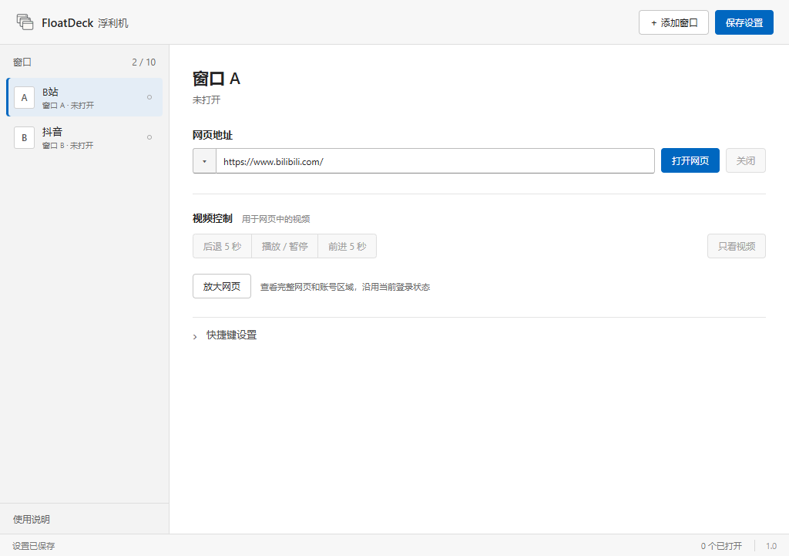
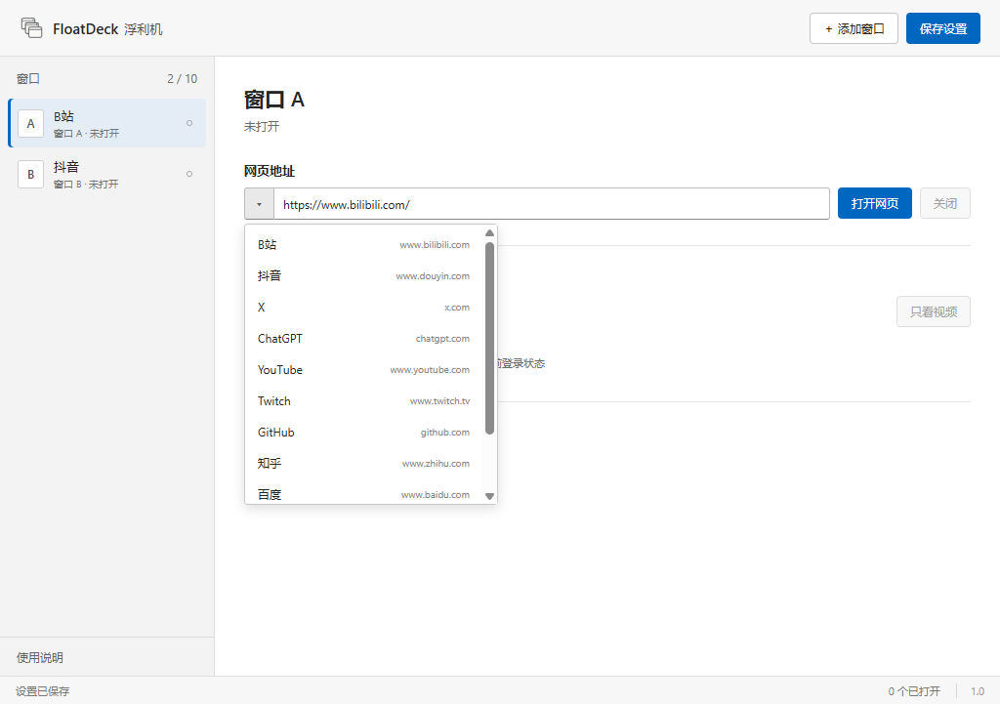

# FloatDeck

[简体中文](README.md)

Keep walkthroughs, videos and useful web pages above other windows. FloatDeck is a Windows desktop tool with up to 10 always-on-top web windows. Each window can be moved and resized, with separate global shortcuts for supported video controls.

**1.0 preview.** Feedback through Issues is welcome. Testing has mainly taken place on the developer's Windows 11 x64 computer; more feedback from other devices is needed. The application interface is currently in Chinese.



## What you can do

- Keep a walkthrough on top beside a borderless or windowed game.
- Open Bilibili, Douyin or other web pages in separate floating windows.
- Assign separate play/pause and seek shortcuts to each supported player. Douyin recommendation feeds can also expose previous/next controls.
- Choose common websites from the address menu or enter your own URL.

Controls follow the capabilities of each page. Ordinary pages hide video controls, and non-seekable videos hide seek controls. Ten is the window limit; performance depends on the hardware and page workload.



## Download and use

1. Open the 1.0 preview under **Releases** on this repository.
2. Download `FloatDeck-1.0.0-windows-x64.zip` and extract the whole folder.
3. Run `FloatDeck.exe` and keep the accompanying files. Sign in to each website yourself on first use.
4. Select a window, enter a URL and click 打开网页 (Open web page). Drag the title bar to move it and the edges to resize it.
5. Click 放大网页 (Enlarge page) to view the full page and account area. Click 返回浮窗 (Return to floating window) when finished.

Shortcut changes save automatically. Click 保存设置 (Save settings) for other changes. Closing the main panel exits all floating windows. The current build is unsigned.

## Accounts and local data

Website sessions are separate from Edge and stored under the current Windows user's `%APPDATA%\duoview`. Closing, reopening and updating the app reuse this directory; preserve it when updating. Each user signs in on their own device initially.

Login recovery records are encrypted locally. Committed records can recover from interrupted writes, and temporary write failures retry automatically. A website can still expire or revoke a session or request verification. Deleting local data can also require another sign-in. Never upload the profile directory, login backups or cookies to an issue.

## Current scope

- A Windows x64 build is provided. The app UI is in Chinese.
- Website presets are address shortcuts; they do not imply that every site's login or video controls have been validated.
- The video view attempts to retain native Bilibili and Douyin danmaku. Website changes may affect rendering or controls.
- Exclusive fullscreen, some games' input handling and other devices still need testing.
- Always-on-top has worked in the developer's daily use. An automatic topmost check fails in the current environment and remains under investigation.

## Run from source

On Windows x64 with Node.js 24 or later, run these commands from the project directory:

```sh
npm ci
npm start
```

Run `npm test` for configuration and recovery-file tests, and `npm run test:session` for login lifecycle tests. Run `npm run build:portable` to create the portable build; preserve an existing build before creating a new output directory.

Built with Electron, JavaScript, HTML and CSS. Implementation and validation notes are available in `docs/`.

## Feedback and contributions

Open **Issues → New issue** and choose a Chinese or English report template. Include the app and Windows versions, website, reproduction steps, expected behavior and actual behavior. Hide account information and personal content in screenshots.

Feature proposals and Pull Requests are welcome. Explain the behavior and how the change was checked.

## License

[MIT](LICENSE)
