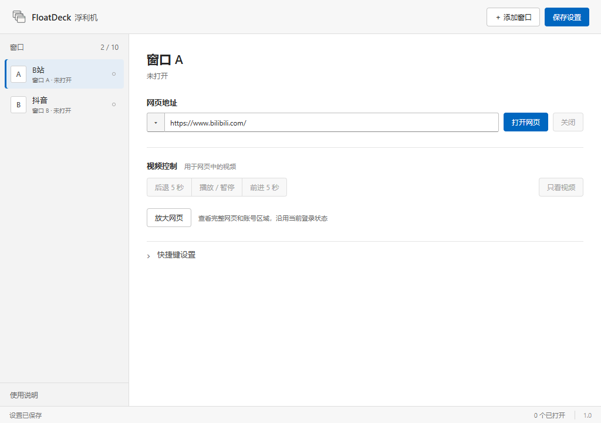
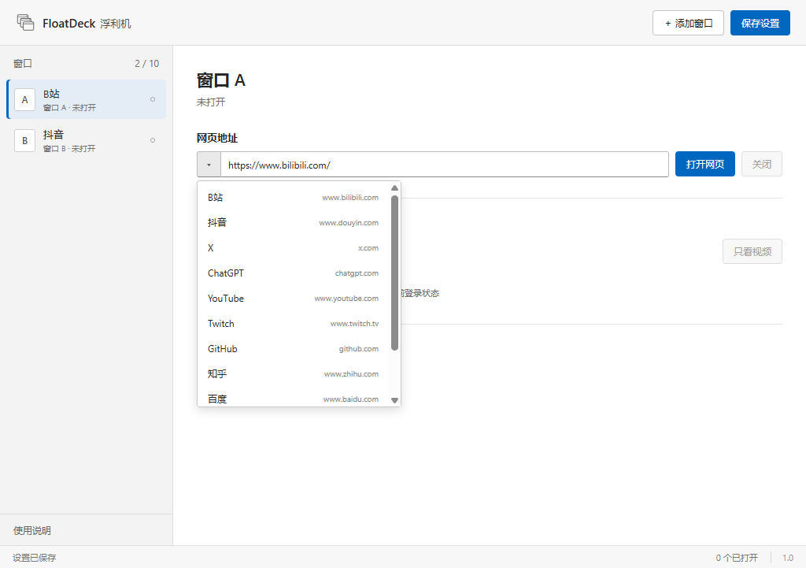

# FloatDeck 浮利机

[English](README.en.md)

**[下载 Windows x64 安装版](https://github.com/xiaosunsun1104/FloatDeck/releases/download/v1.0.0/FloatDeck-Setup-1.0.0-x64.exe)** · [免安装 ZIP](https://github.com/xiaosunsun1104/FloatDeck/releases/download/v1.0.0/FloatDeck-1.0.0-windows-x64.zip) · [查看版本说明](https://github.com/xiaosunsun1104/FloatDeck/releases/tag/v1.0.0)

把攻略、视频和常用网页置顶显示在其他窗口上方。FloatDeck 是一款 Windows 桌面工具，可同时打开最多 10 个置顶网页浮窗，每个窗口都能移动、缩放，并为支持的视频分别设置全局快捷键。

**1.0 预览版**，欢迎试用并通过 Issues 反馈。目前主要在开发者的 Windows 11 x64 电脑上测试，跨设备兼容性仍需更多反馈。

## 我为什么做 FloatDeck

我是一名游戏爱好者，玩游戏时偶尔需要看攻略。但一边玩游戏、一边用浏览器看攻略时，想随时暂停视频、快进或后退，并不方便。

所以我做了 FloatDeck，方便自己，也希望能帮到和我有同样困扰的人。



## 你可以用它做什么

- 玩无边框或窗口化游戏时，把攻略网页置顶放在旁边。
- 同时查看 B站、抖音或其他网页，每个窗口分别移动和缩放。
- 给各窗口设置独立的播放暂停、前进和后退快捷键；抖音推荐页还可设置上一条和下一条。
- 从网址框左侧的菜单选择常用网站，也可以自行输入网址。

控制项随页面能力显示。普通网页隐藏视频控制，直播等不能跳转的视频不显示按秒快进后退。10 个是窗口数量上限，实际流畅度取决于电脑和网页负载。



## 下载和使用

1. 点击上方的 **下载 Windows x64 安装版**，浏览器会下载 `FloatDeck-Setup-1.0.0-x64.exe`。
2. 打开安装程序，选择安装位置并完成安装。安装程序会创建桌面和开始菜单快捷方式。
3. 从快捷方式启动 FloatDeck。首次使用请在网站内自行登录；已用过便携版的同一 Windows 用户继续使用原来的本地资料。
4. 选择窗口、填入网址，再点击“打开网页”。拖动标题栏移动，拖动边缘缩放。
5. 要查看完整网页和账号区域，点击“放大网页”；完成后点击“返回浮窗”。

快捷键修改后自动保存，其他设置修改后点击“保存设置”。关闭主面板会退出全部浮窗。发布包目前未签名。

也可以下载上方的 **免安装 ZIP**，解压整个文件夹后运行其中的 `FloatDeck.exe`，保留同目录的其他文件。安装版可从 Windows 设置的“已安装的应用”中卸载；卸载保留本地设置和网站资料。

## 登录与本地数据

网站账号与 Edge 分开保存，数据位于当前 Windows 用户的 `%APPDATA%\duoview`。正常关闭、重开和更新沿用同一资料目录；更新软件时保留此目录。每位用户首次使用需要自行登录。

程序在本机加密保存登录恢复记录，并支持已提交记录的中断恢复和临时写入失败重试。网站撤销凭证、登录到期、安全验证或本机数据被删除时，仍可能需要重新登录。请勿将自己的数据目录、登录备份或 Cookie 上传到 Issues。

## 当前范围

- 当前提供 Windows x64 发布包，程序界面为中文。
- 内置网站选项是地址入口，不代表每个网站的登录和视频控制都已适配。
- B站与抖音的纯视频视图尝试保留原生弹幕；网站改版可能影响显示和控制。
- 独占全屏、部分游戏的按键处理和其他电脑的表现仍需验证。
- 开发者连续日常使用中置顶可用；当前环境的一项自动置顶检查异常仍在调查。

## 从源码运行

使用 Windows x64 和 Node.js 24 或更新版本，在项目目录中运行：

```sh
npm ci
npm start
```

配置与恢复文件测试：`npm test`。登录生命周期测试：`npm run test:session`。生成 Windows 安装包：`npm run build:installer`，输出为 `dist/FloatDeck-Setup-1.0.0-x64.exe`。安装、重复安装及卸载检查：`npm run test:installer`，使用独立测试标识和快捷方式，不启动真实用户资料。

生成 Windows 便携包：`npm run build:portable`；输出目录已存在时，先另存旧构建以免覆盖。

项目使用 Electron、JavaScript、HTML 和 CSS。登录、更新、后台控制和网站适配的实现记录见 `docs/`。

## 反馈和参与

在 **Issues → New issue** 中选择中文或英文的问题反馈模板。请说明软件版本、Windows 版本、网站、复现步骤、预期结果和实际结果。截图请遮住头像、账号、聊天和其他个人信息。

欢迎通过 Issue 提议功能，或提交 Pull Request。相关行为和验证方式请写清楚。

## 许可证

[MIT](LICENSE)
